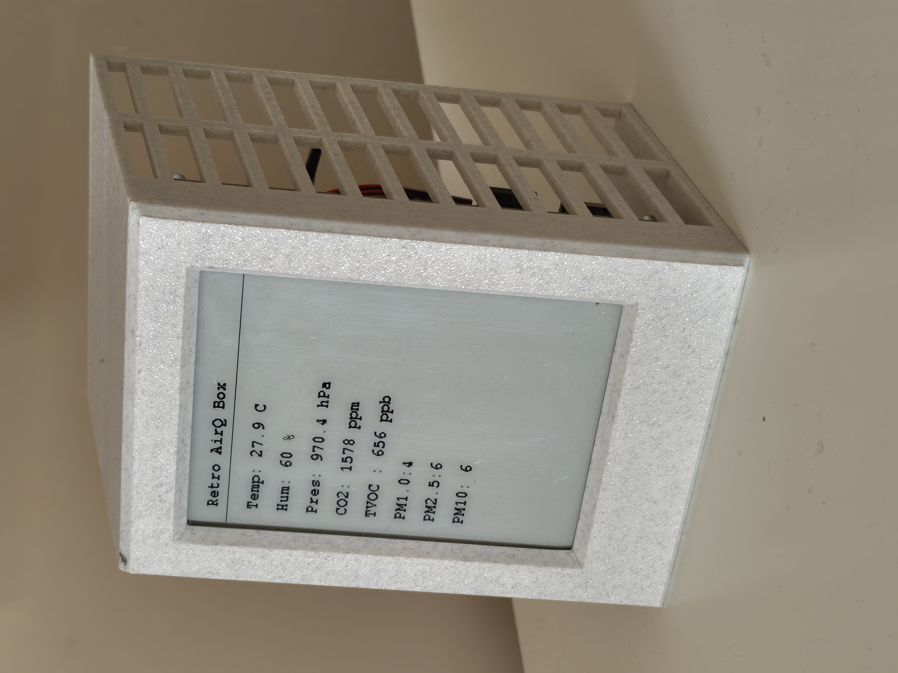
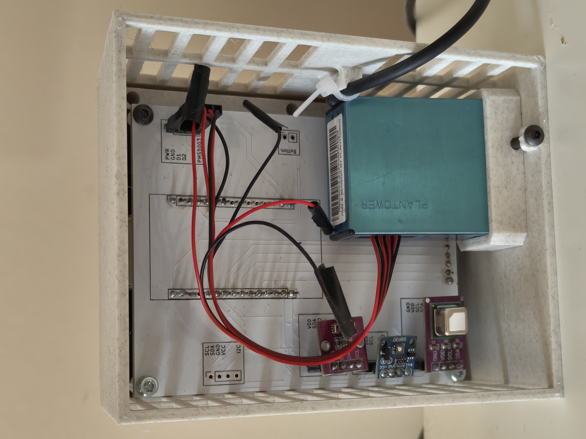
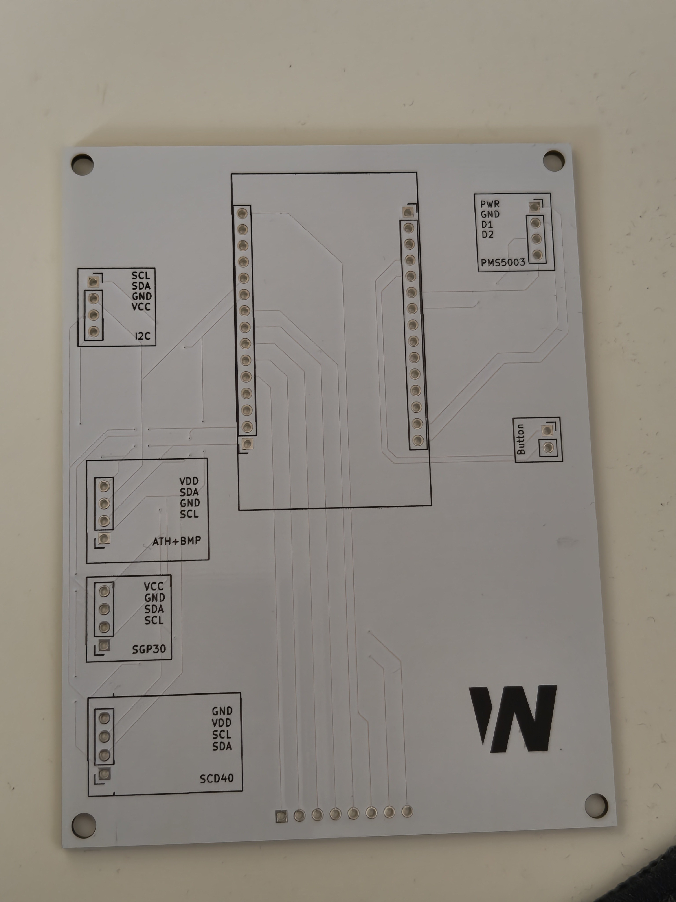
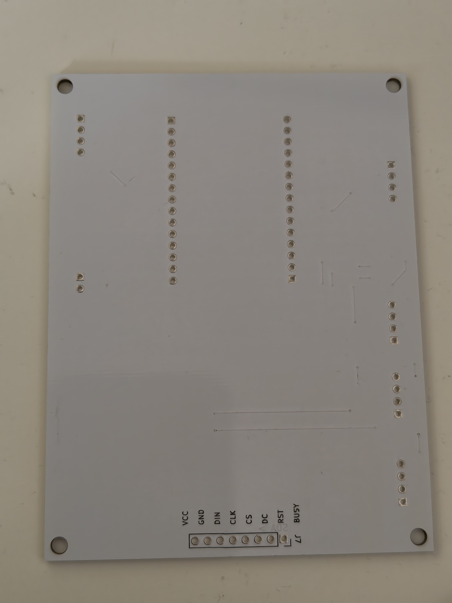
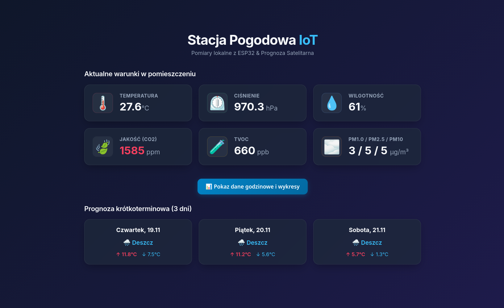
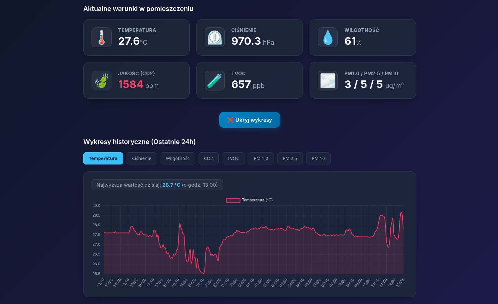

# AirQBox
Simple air quality measuring box. 

  
  

The project uses a custom PCB ordered from JLCPCB. It isn't required to build the box, but it makes wiring much easier and gives the whole setup a much cleaner look. The PCB is also prepared for additional components, such as a button or another I2C sensor, and does not have to be fully populated as shown in the photos above.

  
  

A potential use case is a home IoT weather station using web interface and OpenWeather API.

  

  

